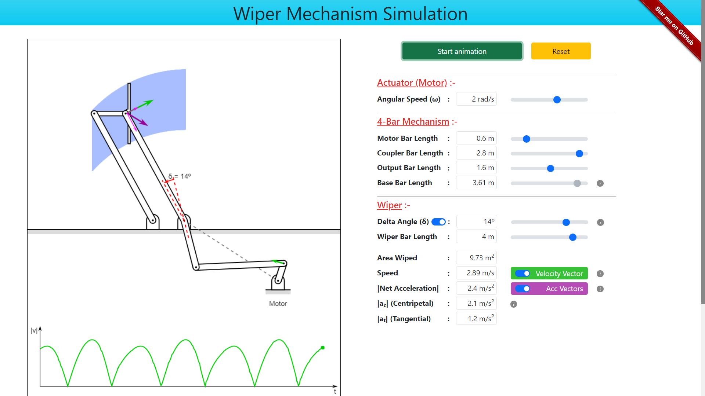
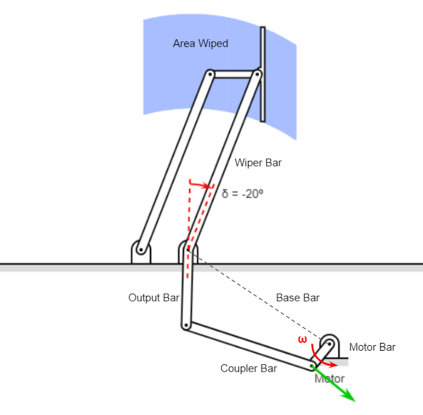

# Wiper Mechanism Simulator

An interactive browser simulation of a windshield wiper driven by a four-bar linkage. Change the bar lengths and motor speed, watch the mechanism move in real time, and read off velocities, accelerations and the area wiped.

**Live demo:** [jeevesh28.github.io/Wiper-Mechanism](https://jeevesh28.github.io/Wiper-Mechanism/index.html)

> **Team:** Jeevesh Mahajan, [jatin-47](https://github.com/jatin-47)

<table align="center">
  <tr>
    <td align="center"></td>
    <td align="center"></td>
  </tr>
  <tr>
    <td align="center"><sub>Live animation</sub></td>
    <td align="center"><sub>Full interface: controls, readouts and |v|, |a| plots</sub></td>
  </tr>
</table>

**Stack:** JavaScript · HTML5 Canvas · PrairieDraw.js · Sylvester.js

---

## How it works



A windshield wiper turns a motor's continuous rotation into a back-and-forth sweep. The simulator models it as a **four-bar linkage** driving a **parallelogram wiper arm** (labels match the diagram):

- **Four-bar linkage:** the motor bar **O₂A** (crank) rotates at angular speed ω, the coupler **AB** transmits that motion, and the output bar **BO₄** rocks back and forth about **O₄**. The base bar **O₂O₄** is fixed.
- **Wiper arm:** the wiper bar extends from **O₄** at an offset angle **δ** to the output bar. Together with the parallel link **O₆D** and the top bar **DC**, it forms a parallelogram, so the blade at **C** stays upright as it sweeps.

On each animation step, the crank advances by a fixed angle, the coupler and rocker angles are computed from the linkage geometry, and the wiper's pose follows from the rocker. Differentiating those positions over time gives each joint's **velocity** and its **centripetal and tangential acceleration**, which are drawn as vectors and plotted against time. The sweep of the blade gives the **area wiped**.

<br clear="right">

## Features

- **Real-time simulation** at smooth frame rates on an HTML5 canvas.
- **Adjustable parameters** (bar lengths, base distance, motor speed), editable while the animation runs.
- **Kinematics plots** of speed and acceleration magnitude against time.
- **Toggleable vectors** for velocity and acceleration at each joint.
- **Derived quantities:** area wiped, velocity, acceleration and their components.
- **Inline help** via "i" buttons, and a reset to default settings.

## Running it

No build step. Open the [live demo](https://jeevesh28.github.io/Wiper-Mechanism/index.html), or clone the repo and open `index.html` in a browser.

Usage: set the parameters, click **Start Animation**, toggle the vector overlays as needed, and click **Reset** to restore the defaults. The full [user manual](User%20Manual/userManual.html) and [developer manual](User%20Manual/developerManual.html) are in `User Manual/`.

## Repository layout

```
index.html                 simulator page
js/script.js               linkage geometry, kinematics, animation loop
js/PrairieDraw.js          drawing library for technical diagrams
js/sylvester.js            vector math used by PrairieDraw
css/                       styles
User Manual/               user and developer documentation
LaTeX Image generator/     renders LaTeX labels to images for the canvas
```

## Credits

Drawing uses [PrairieDraw.js](https://github.com/martin70/PrairieDraw.js), which builds on the `Sylvester.Vector` class from [Sylvester.js](http://sylvester.jcoglan.com/docs.html).
